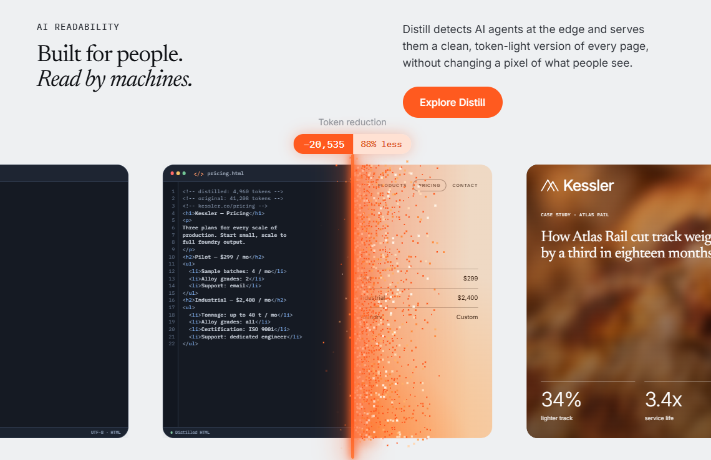

# WebDesign9-PageToCode



一个以「Built for people. Read by machines.」为主题的 Distill 交互页面。六张 Kessler 迷你网站沿传送带移动，经过橙色扫描线后，转换为带行号和语法高亮的深色 HTML 编辑器面板；粒子溶解与 token 计数同步变化。

## 运行

直接用浏览器打开 [`index.html`](./index.html)，或在项目目录启动静态服务器：

```bash
python -m http.server 5175 --bind 127.0.0.1
```

随后访问 [http://127.0.0.1:5175/](http://127.0.0.1:5175/)。

## 交互

- 自动向左滚动，鼠标悬停时减速。
- 双向拖拽并带释放惯性；向右拖拽可从代码重建网站。
- 支持横向滚轮和左右方向键。
- 响应式布局，并遵循系统的「减少动态效果」偏好。

## 实现与资源

HTML、CSS 和原生 JavaScript 全部包含在一个文件中，无框架、无外部 JavaScript 库、无构建步骤。网站卡片使用 DOM，扫描粒子使用 Canvas，共享一个动画循环。

Inter、Newsreader（含斜体）和 IBM Plex Mono 的 Latin WOFF2 字体已以 Base64 内嵌。六张照片使用原规格指定的 CloudFront WebP 地址，加载图片需要联网。

Distill 与 Kessler 均为示例产品。导航按钮展示概念说明，不连接真实的注册、支付或预约服务。
